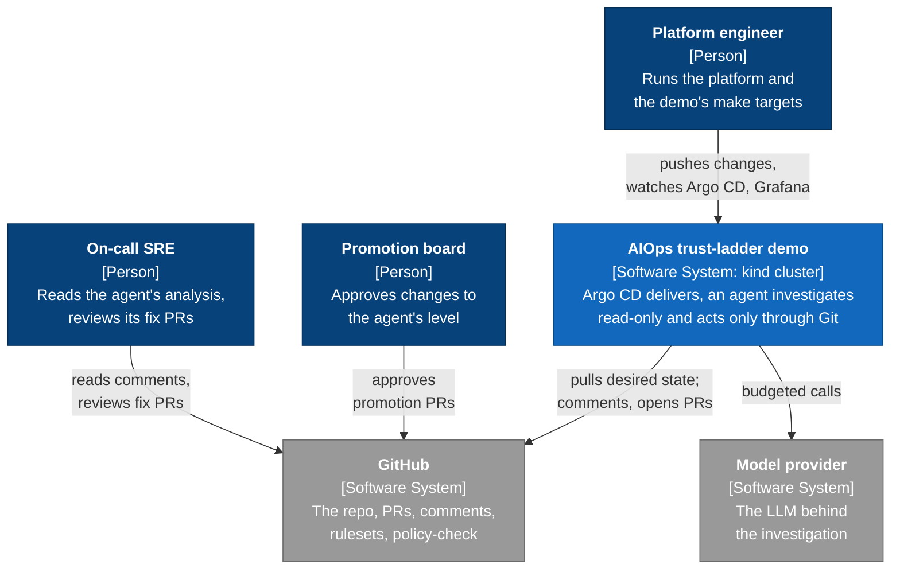
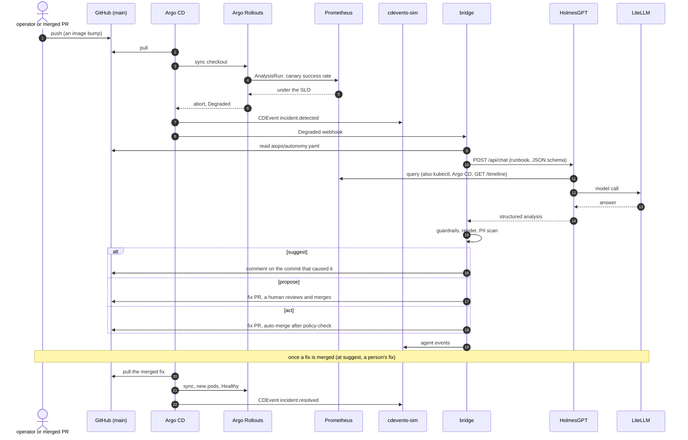

# Observability Is a Platform Problem Now: Closing the AIOps Loop with ArgoCD and GitOps

For the ArgoCon North America 2026 talk by Luke Philips and Hilliary Lipsig
([session page](https://cncf-hosted-co-located-events-north-america-2026.sessionize.com/session/1269302)).

A demo of an AIOps agent that earns the right to act. An Argo CD rollout fails, the platform
records it as CDEvents, an agent investigates read-only, and the result goes back into Git as a
comment, a pull request, or a pull request that merges itself. What the agent may do is itself a
file in Git, and raising it is a reviewed pull request.

## What This Demonstrates

One incident, replayed at three levels of trust (the **trust ladder**):

| Rung | Level | What the agent does | Who acts |
|------|-------|---------------------|----------|
| 1 | `suggest` | Posts its root-cause analysis as a comment on the cause commit (or on the PR that merged it). | A human fixes it. |
| 2 | `propose` | Opens a two-line fix PR with the analysis and evidence in the body. | A human reviews and merges. |
| 3 | `act` | Opens the same PR and turns on auto-merge. It merges only after `policy-check` passes, which GitHub enforces as a required status. | A human reviews afterwards. |

The incident is the same each time. A change lowers a timeout (`UPSTREAM_TIMEOUT_MS`, 2000 to
200) without bumping the pod template's config-version annotation. The next image deploy starts
canary pods that read the new value, the canary fails its success-rate gate, and Argo CD reports
the `checkout` application Degraded. Argo CD Notifications then send the agent a webhook.

More on the incident in [docs/03](docs/03-the-incident.md), and on the ladder, with promotion and
demotion, in [docs/02](docs/02-trust-ladder.md).

## Architecture

The system context ([C4](https://c4model.com/) level 1): who uses the demo and what it depends
on. The containers inside the cluster (level 2) are in
[docs/01](docs/01-architecture.md#containers), and the bridge's components (level 3) in
[docs/04](docs/04-bridge-and-holmes.md#components).



### One incident, end to end

The autonomy level in `aiops/autonomy.yaml` decides what the bridge does at the end (the
`alt` block). Every other step is the same at every rung.



## Quick Start

This fork uses a ChatGPT subscription through LiteLLM. You need Docker, the pinned CLI tools
(`make vendor` checks them), a ChatGPT device login, and a GitHub App
for rungs 1 to 3. [docs/07](docs/07-setup.md) lists the tools and secrets and covers running it
from your own fork; [docs/github-setup.md](docs/github-setup.md) covers the App and rulesets.

```bash
cp .env.example .env && chmod 600 .env     # then fill in the keys
make brew                                  # optional: brew bundle installs the CLI tools (not Docker)
make vendor                                # tools present and at the pinned versions
make chatgpt-login                         # authorize the subscription backend
make operator-clone                        # the clone the operator scripts push from
make build-all                             # kind cluster and the whole stack (~5 min, safe to run twice)
make reset-rung-1                         # prepare the first scene
make demo-rung-1                           # suggest: incident, agent comment, human fix
```

Argo CD pulls from GitHub, so the cluster follows what is pushed to `main` (`TRACKED_BRANCH` in
[demo.env](demo.env)). `make rebuild` deletes the cluster and builds it again. The cluster has
its own kubeconfig, `.kube/argoconna26.yaml`, and the make targets never touch your default one.

| Service | URL | Login |
|---------|-----|-------|
| Argo CD | http://127.0.0.1:30080 | `admin`; password is `ARGOCD_ADMIN_PASSWORD` in your `.env`, or from `make -s argocd-password` |
| Grafana | http://127.0.0.1:30030 | `admin`; password is `GRAFANA_ADMIN_PASSWORD` in your `.env` |
| Prometheus | http://127.0.0.1:30090 | none |
| Bridge | http://127.0.0.1:30081 | `/status`, `/metrics`, `/healthz` |
| cdevents-sim | http://127.0.0.1:30082 | `/timeline`, `/incidents`, `/events` |
| LiteLLM | http://127.0.0.1:30400 | master key from your `.env` |

## Demo Flow

The talk runs as one script, scene by scene, with no resets in between:

| Scene | What happens | Key concept |
|-------|-------------|-------------|
| **Cold open** (`demo-cold-open`) | 5 p.m.: the mandate to use AI, and an agent bolted onto the platform. 2:15 a.m.: the page. "What changed?" | Starting state: autonomy `suggest` |
| **Prologue** (`demo-prologue`) | Argo CD all green; the Grafana timeline with delivery events beside the error rate; PR-242's 200 ms timeout in the live ConfigMap; the app's owner, tier and SLO labels; the trust ladder | Delivery events as CDEvents, a shared language |
| **Scene 1** (`demo-scene-1`) | An innocent image bump; the canary aborts on a Prometheus gate; the agent comments on the older commit that caused it; a human fixes it | Rung 1, `suggest`: look, don't touch |
| **Scene 2** (`demo-scene-2`) | A promotion PR raises the level and the promotion board approves it; the incident again; the agent opens a two-line fix PR; a human reviews and merges | Rung 2, `propose`: autonomy as config, promoted by PR |
| **Scene 3** (`demo-scene-3`) | The `act` promotion; `make night` runs the nightly job; the agent's PR passes `policy-check` and merges with no human; the after-the-fact review | Rung 3, `act`: auto-merge only inside guardrails |
| **Epilogue** (`demo-epilogue`) | Human touch-points per rung on the dashboard; what is real and what is stood in; `make demote` back to `suggest` | Trust goes down as easily as it goes up |
| **Close** (`demo-close`) | Back to the timeline, where the signal now lives | |

`DEMO_PACE=talk` (the default) stops for Enter at each scene break, speaker's beat and line of
narration; `DEMO_PACE=auto` runs unattended with the checks on. What to do when a scene stops,
how to jump to a scene, the rung scripts, recordings and stage day are in
[docs/06](docs/06-operations.md#scenes-and-demo-full).

## What's Real

- **Real:** the cluster, Argo CD, Argo Rollouts, Prometheus and Grafana; the incident (a real
  timeout against a slow dependency, caught by a real canary gate); HolmesGPT with a real model
  behind LiteLLM, on a read-only role.
- **The bridge is the only writer.** Every agent action is a pull request or a comment, never a
  direct cluster write, and GitHub rulesets, not the bridge, stop the App from pushing to `main`.
- **Stood in:** `cdevents-sim` for a CDEvents collector, and the operator scripts for the forge
  that would send change events. The prompt is a one-scenario runbook, and time is compressed.

The full list, and which rules GitHub enforces versus the bridge, is in
[docs/08](docs/08-whats-real.md).

## Scoring the agent

`make dry-runs N=20 BATCH=5` scores the agent on re-armed incidents without posting anything.
The latest run matched the root cause 20/20 (4 incidents, 5 runs each, median answer 28 s), and
a promotion needs `PROMOTION_SCORE_BAR` (20/20). How it is scored, and the limits of that number,
are in [docs/06](docs/06-operations.md#scoring-the-agent-the-dry-run-harness).

## Docs

| Page | What it covers |
|------|----------------|
| [00 Index](docs/00-index.md) | Reading paths, key design decisions, the repo structure and tests |
| [01 Architecture](docs/01-architecture.md) | Containers (C4 level 2), data flow, CDEvents, ports, version pins |
| [02 The Trust Ladder](docs/02-trust-ladder.md) | `aiops/autonomy.yaml`, the three levels, promotion and demotion |
| [03 The Incident](docs/03-the-incident.md) | The timeout change, why it slips past a rollout, why a naive revert looks green |
| [04 Bridge and HolmesGPT](docs/04-bridge-and-holmes.md) | The bridge's components (C4 level 3), guardrails, PII scan, read-only RBAC, LLM budget |
| [05 Policy](docs/05-policy.md) | Golden-path labels, Git facts, the auto-fix rules, `policy-check` |
| [06 Operations](docs/06-operations.md) | Make targets, resets, scenes, recordings, dry runs, stage day, retarget |
| [07 Setup](docs/07-setup.md) | Tools, secrets, running it from your own fork |
| [08 What's Real](docs/08-whats-real.md) | Real versus stood in, and what GitHub enforces versus the bridge |
| [GitHub setup](docs/github-setup.md) | The GitHub App, rulesets and repository settings |

## References

- [Argo CD](https://argo-cd.readthedocs.io/), [Notifications](https://argo-cd.readthedocs.io/en/stable/operator-manual/notifications/)
- [Argo Rollouts](https://argo-rollouts.readthedocs.io/) and its Prometheus analysis provider
- [CDEvents](https://cdevents.dev/) specification v0.5.1
- [HolmesGPT](https://holmesgpt.dev/)
- [LiteLLM](https://docs.litellm.ai/)
- [GitHub repository rulesets](https://docs.github.com/en/repositories/configuring-branches-and-merges-in-your-repository/managing-rulesets/about-rulesets) and [CODEOWNERS](https://docs.github.com/en/repositories/managing-your-repositorys-settings-and-features/customizing-your-repository/about-code-owners)
- [Open Policy Agent / Rego](https://www.openpolicyagent.org/docs/latest/policy-language/) and [conftest](https://www.conftest.dev/)
- [kind](https://kind.sigs.k8s.io/)

<!-- credits: held -->

## License

MIT. See [LICENSE](LICENSE).
